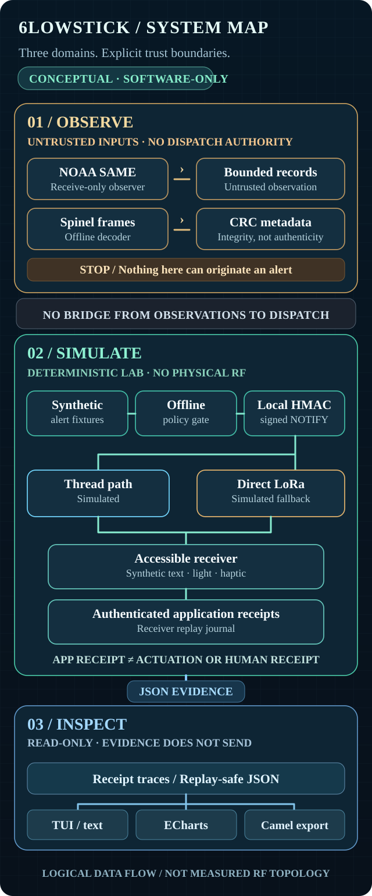

<div align="center">
  

  <h1>6lowStick</h1>
  <p><strong>Find your people. Signal what matters.</strong></p>
  <p>6lowLoop finds your people. 6lowFlare models short-lived group signals and bounded relay. 6lowStick studies how low-power signals become independently observable physical notifications.</p>
  <p>
    <a href="https://mcc0nnell.github.io/6lowstick/"><strong>Explore the Field Station ↗</strong></a>
    &nbsp;·&nbsp; <a href="#why-6lowstick">The idea</a>
    &nbsp;·&nbsp; <a href="#6lowloop-find-your-people">6lowLoop</a>
    &nbsp;·&nbsp; <a href="#6lowflare-signal-what-matters">6lowFlare</a>
    &nbsp;·&nbsp; <a href="#try-the-lab">Try the lab</a>
    &nbsp;·&nbsp; <a href="#what-we-can-show">Evidence and limits</a>
    &nbsp;·&nbsp; <a href="#openthread-and-ai">OpenThread + AI</a>
    &nbsp;·&nbsp; <a href="docs/README.md">Research guide</a>
  </p>
  <p><code>APACHE-2.0</code> &nbsp; <code>NODE 22+</code> &nbsp; <code>EXPERIMENTAL</code> &nbsp; <code>SIMULATION FIRST</code></p>
</div>

> [!IMPORTANT]
> **Research software, not an emergency warning system.** The alert fabric, Thread/direct-LoRa fallback, and receiver scenarios are software-only. There is no demonstrated on-air delivery, physical actuation, or human receipt. Do not use this code to originate operational warnings.

**Release state:** `v0.1.0-rc.1` is a **prepared, untagged source-only release candidate**, not an npm package or a published GitHub Release. See the [release checklist](docs/release-candidate.md), [changelog](CHANGELOG.md), and [security policy](SECURITY.md).

## Why 6lowStick

**Crack a glow stick. Wave it. Someone understands that you're signaling something.** No app or dashboard needed to recognize that something is happening.

That's the ambition behind 6lowStick: an open, low-power way to **make a signal physical**. A presence, a request, a sensor condition, a coordination cue, or an emergency could become a light, vibration, text notification, or relayed signal. The meaning comes from its authorized source and context, not from a single hard-coded emergency use case.

A digital signal can leave the sender and never reach a receiver. It can reach an application without turning on a light or vibrating a device. A device can activate without anyone noticing it.

**Transmission, application receipt, physical activation, human detection, and human understanding are distinct events.** 6lowStick investigates the evidence between them. Accessibility belongs at the center: a signal must be perceivable in a form that works for the recipient.

Emergency alerting is one demanding application, **not the definition of the project**. Today 6lowStick is a controlled, alert-shaped *simulation laboratory*; it does not yet implement arbitrary-purpose signaling, on-air delivery, or validated physical notifications.

## 6lowLoop: find your people

**Sam wanted to find his friends. So do we.** Friend-finding is a **core 6lowStick capability**, not an optional experiment. With mutual consent, people should eventually be able to find reachable friends, ping them, coordinate a rendezvous, and signal a need, even when cellular infrastructure fails.

**Matrix is the planned account, verified-device, encrypted messaging and group layer.** 6lowLoop adds local, short-lived friend presence and signaling over separately validated transports. Matrix federation requires a homeserver; an isolated radio mesh is not automatically a Matrix deployment.

The first executable slice implements opt-in, in-memory presence and ping/ACK framing between **pre-paired Matrix-ID-labeled friends**: `npm run loop:demo`. It does **not** connect to Matrix, discover people over a radio, obtain location or prove human receipt. See the [6lowLoop architecture and gates](docs/6lowloop.md).

## 6lowFlare: signal what matters

**6lowLoop finds your people. 6lowFlare lets your people signal.** Send a short-lived `here`, `rendezvous`, `attention`, or `assistance` code to an explicitly provisioned audience; an authorized neighbor can relay it with a bounded hop budget. No location, free text, or Matrix IDs are placed in the frame.

The **first executable slice** is an in-memory, HMAC-authenticated model with opt-in receivers and separate opt-in relays, expiry, replay rejection and explicit unknown physical/human outcomes: `npm run flare:demo`. It has **no actual broadcast, radio, GPS, Matrix account, encryption, device activation or public channel**. Shared audience keys are pre-provisioned and do not establish individual sender attribution or real group consent. [See the 6lowFlare protocol, limitations and integration gates](docs/6lowflare.md).

## OpenThread and AI

**The signal is the point. OpenThread is one way to carry it. AI is one way to interpret it.**

OpenThread could provide local, low-power IPv6 connectivity between signaling endpoints. An edge service could interpret observations and recommend how to respond; deterministic policy—not a language model—would authorize any future physical action. 6lowStick would preserve the evidence trail: what was requested, where delivery was attempted, which application acknowledged it, and what still requires physical or human verification.

A deterministic, **offline and read-only** trace reviewer now checks typed claims against committed synthetic fixtures and cites their evidence. It is **not an AI model**, does not evaluate arbitrary prose, and has no dispatch or actuator authority. Integrating an AI evaluator remains proposed.

Future direct-LoRa relaying would be a **separate application transport**, not a longer-range OpenThread mesh. Today the Thread work uses POSIX simulated radio and LoRa remains scripted; neither demonstrates physical RF failover or life-safety performance.

[Read the full OpenThread + AI research architecture →](docs/ai-physical-systems.md) for the proposed trust boundaries, evidence ladder, and research gates.

## How it works

The current instruments explore narrow, software-only signaling and notification protocols. The full physical glow-stick vision above is **not** implemented by these lanes.

| Research lane | What it does | What it does **not** establish |
| --- | --- | --- |
| **Observe** | Parses receive-only NOAA/SAME decoder lines and offline Spinel frames. | Authenticity of an external warning, or permission to dispatch one. |
| **Simulate** | Runs local authenticated application-message and replay tests over OpenThread POSIX and scripted Thread/direct-LoRa routes. | Actual 802.15.4 or LoRa RF delivery. |
| **Inspect** | Exposes attempts, application receipts, duplicate suppression, and synthetic receiver-journal entries in JSON, a text-friendly terminal, and the Field Station. | Physical actuation, human perception, or understanding. |

The observation and simulation lanes are deliberately separate. NOAA data cannot trigger the synthetic sender, and an application receipt cannot become a claim that a human was reached.

## Try the lab

**[Open the Field Station →](https://mcc0nnell.github.io/6lowstick/)**

Five deterministic scenarios let you inspect an unavailable Thread route, a scripted direct-LoRa fallback, invalid or missing receipts, and duplicate suppression. The diagram is an illustration of **model decisions**, not captured RF topology. The text table and raw JSON remain usable without a chart.

For a quick local run, clone the repository with **Node.js 22+**:

```bash
git clone https://github.com/mcc0nnell/6lowstick.git
cd 6lowstick
npm ci
npm test

npm run loop:demo                 # 6lowLoop opt-in, process-local friend protocol model
npm run flare:demo                # 6lowFlare opt-in, bounded group relay model
npm run tui -- --demo --report    # Accessible, noninteractive text
npm run tui -- --demo             # Keyboard-operated Mesh Control
npm run evidence:multiradio       # Deterministic synthetic scenarios
npm run evidence:review           # Offline trace judgments and exact evidence pointers
# Optional: review externally generated PR #8 POSIX *simulation* evidence
npm run evidence:review -- --posix /path/to/mesh-run.json
```

`--demo` uses illustrative data. For a static, no-color terminal snapshot use `npm run tui -- --demo --snapshot --plain`. Interactive display has reduced-motion support. To replay separately generated POSIX simulator evidence use `npm run tui -- --input evidence/mesh-run.json` after creating that local file.

**Optional Camel 4.22.1 observer:** `npm run camel:export -- --demo` writes sanitized evidence copies, and `camel run integrations/camel/mesh-observe.camel.yaml` consumes them through a file-only log route. It does not send signals or authorize physical actions. See [the development-only Camel observer guide](integrations/camel/README.md); Camel is not required for the TUI or lab.

**OpenThread is a separate toolchain.** Building or supplying a compatible `ot-cli-ftd` and setting `OT_CLI_PATH` enables the opt-in POSIX lab via `bash scripts/run-evidence.sh`; the repository does not pin or build that binary. See [reproduction notes](experiments/thread-alert/README.md) and [measured Node-harness event limitations](docs/monotonic-evidence.md).

## What we can show

| Instrument | Demonstrated in software | Not demonstrated |
| --- | --- | --- |
| **6lowFlare** | Offline pre-provisioned group flare admission, signed cooperative hop decrement, explicit relay opt-in, expiry and replay suppression | RF broadcasting, Matrix/group identity, encryption, physical activation or human acknowledgment |
| **Thread alert lab** | OpenThread POSIX simulated traffic, local HMAC, replay journal, synthetic modalities | RF delivery or reliably reaching a person |
| **Multi-radio fabric** | Scripted Thread/direct-LoRa cases plus an opt-in OpenThread POSIX simulated-radio UDP receipt/failover exercise with authenticated application ACKs and duplicate suppression | Physical Thread/LoRa RF, LoRaWAN, reliable delivery or human receipt |
| **NOAA/SAME observer** | Receive-only decoder-line parsing and mock/replay input | Origin authentication or field measurement |
| **Spinel Flight Recorder** | Offline HDLC-lite parsing, CRC/FCS, command metadata, reference vectors | Live RCP instrumentation or authenticated origin |
| **Matter adapter** | Pinned SDK seam and mock endpoints | Commissioned hardware or measured output |
| **Mesh Control / Field Station** | Read-only evidence exploration, text reports and modeled event playback | On-air topology, RF packet timing or human outcomes |
| **Camel exporter / observer** | Sanitized evidence export and an optional, locally verified Camel 4.22.1 file-only logging route | Operational alert routing or production runtime |
| **Offline trace reviewer** | Evidence-grounded typed claim checks over scripted fixtures and optional locally generated POSIX simulation reports | AI model validation, field measurements, or human outcomes |

**Optional POSIX multi-radio experiment:** A separately built OpenThread `ot-cli-ftd` exercises F1 challenges and authenticated R2 application receipts over simulated-radio UDP, including withheld receipts and a stopped receiver. LoRa fallback remains **scripted software-only**, and this optional external simulator is **not built or pinned in CI**. See [the multi-radio protocol and reproduction notes](docs/multiradio-fabric.md). A successful run is not evidence of physical RF delivery or notification reliability.

### An unresolved result worth keeping

One earlier four-node POSIX simulation intermittently failed to record a haptic application acknowledgment. Later serial simulated trials did not establish physical reliability. An absent ACK is **unconfirmed delivery**, not evidence that no receiver activated. The question remains open; see [the reliability record](docs/threat-model.md#observed-reliability-caveat-2026-10-20) and [trial protocol](docs/reliability-trials.md).

The next meaningful gates are an authorized physical radio bench, independent observation of light/text/haptic actuation, and consent-based studies of whether people notice and understand the notification. More green simulated tests cannot substitute for those measurements.

## Architecture and trust boundaries



[View the full diagram](assets/architecture.svg)

**For readers who don't use the diagram:** receive-only NOAA/SAME and offline Spinel inspection feed an observation lane without dispatch authority. A separate synthetic policy and local HMAC sender models Thread/direct-LoRa routes to receivers; attempts, application ACKs and a replay journal become JSON research evidence. The terminal UI, ECharts Observatory and Camel exporter only **inspect** that evidence. A Spinel CRC validates frame integrity, not provenance. A local ACK confirms modeled application processing, not actuation or perception.

## First Light — next funded milestone

The next milestone is **an independently measured physical signal**, not another simulated application ACK. **The hardware bench is unfunded and has not started.** The local-only [`signal-intent.v0` contract](src/signals/intent.mjs) and [First Light research plan](docs/first-light/README.md) prepare the evidence boundary, but do not connect to a transmitter or actuator. The [12-month funding case](docs/first-light/funding-case.md) outlines a revised $330,000 planning ask, including a $50,000 part-time accessibility, project logistics and grant-tracking role, not a committed award or equipment quote.

## Research guide

The [research guide](docs/README.md) is organized by what you want to do, not by how many subsystems exist:

- **Follow the experiment:** [Multi-radio fabric](docs/multiradio-fabric.md) and [OpenThread POSIX lab](experiments/thread-alert/README.md).
- **Audit the evidence:** [Reliability trials](docs/reliability-trials.md), [Spinel recorder](docs/spinel-flight-recorder.md) and [monotonic event capture](docs/monotonic-evidence.md).
- **Audit an interpretation:** [Offline trace review](docs/trace-review.md) checks exact fixture-grounded claims; no model or dispatch authority.
- **Plan the next phase:** [Physical-radio test protocol](docs/physical-radio-test-protocol.md) and [threat model](docs/threat-model.md).
- **Use the interfaces:** [Field Station design and evidence boundaries](docs/field-station.md) and [Mesh Control TUI](docs/mesh-control-tui.md).

## Meet Rizzer

**Two collars. Zero trust.** Rizzer is the irreverent 6lowStick mascot and the name of a [separate Apache-2.0 native coverage-guided fuzzer](https://github.com/mcc0nnell/rizzer). The original [two-polo artwork](assets/6lowstick-two-polos.webp) remains the source for the cleaned README illustration; [Rizzer's character notes](https://github.com/mcc0nnell/rizzer/blob/main/docs/character.md) and [art script](https://github.com/mcc0nnell/rizzer/blob/main/scripts/prepare_original_logo.py) live in the independent repository.

6lowStick has an **opt-in offline Spinel fuzzing adapter** with retained input replay against its JavaScript recorder, not live radio fuzzing or a confirmed OpenThread vulnerability. Follow the [bounded fuzzing guide](docs/rizzer-spinel-fuzzing.md) to reproduce it. Rizzer's native coverage is not JavaScript coverage.

The mascot also appears in the **read-only** TUI: `npm run tui -- --mascot --plain` for a screen-reader-friendly line, or `--mascot --reduced-motion` for the static view. No fuzzer runs when the mascot is displayed.

---

**Safety and licensing:** Never connect the prototype to public alert origination, operational emergency dispatch, or uncommissioned actuators. NOAA/SAME reception is not authenticated by a local gateway HMAC. [Apache-2.0](LICENSE). WindAnvil and TalkPipe can support development verification but are not runtime dependencies.
