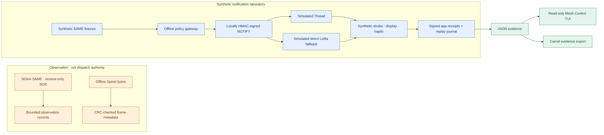

# 6lowStick

**Light the mesh. Make alerts accessible.**

6lowStick is an experimental, open-source research platform for understanding how low-power networks could support **accessible emergency notifications**. It explores the chain from untrusted alert observations through policy, simulated transport, receiver acknowledgments, and evidence inspection. It is **not** an emergency warning service or life-safety product.

## Architecture and trust boundaries



**Legend:** amber = untrusted/offline observations; blue = synthetic laboratory path; green = read-only evidence. Missing arrows are intentional: SDR and Spinel observations are **not connected to alert dispatch**. Edges show logical data flow, not RF topology or measured timing.

These paths are **not automatically connected**: receiving a SAME observation does not authorize a mesh notification. The synthetic fabric does not send real RF traffic. A valid Spinel CRC proves only frame integrity, and an authenticated application receipt is **not** proof of physical actuation or human acknowledgment.

## Quick start (Node.js 22+)

```sh
npm ci
npm test
npm run tui -- --demo
npm run tui -- --demo --snapshot --plain
npm run tui -- --demo --report
# When an OpenThread POSIX lab evidence file exists:
# npm run tui -- --input evidence/mesh-run.json
npm run evidence:multiradio
```

The TUI demo is illustrative; `--report` emits a sequential accessible text view. The multiradio command generates software-only research traces. Neither uses physical radios.

Newly instrumented OpenThread POSIX lab runs include monotonic **Node harness** event observations. Mesh Control replays measured application-event gaps and exposes elapsed milliseconds in its accessible report; older evidence still uses labeled phase reconstruction. These are **not RF packet timestamps or verified physical/human notifications**. To reproduce the separately built OpenThread POSIX lab, set `OT_CLI_PATH=/absolute/path/to/ot-cli-ftd` and run `bash scripts/run-evidence.sh`; the OpenThread binary build is **not** pinned or reproduced by this repository.

## What exists today

| Component | Verified scope | Not established |
| --- | --- | --- |
| Thread alert lab | POSIX simulation, local HMAC, replay journal, three synthetic modalities | Real RF, human notification |
| Dual-radio fabric | Scripted Thread/direct-LoRa fallback, per-attempt signed receipts, duplicate suppression | LoRa hardware, LoRaWAN, physical failover |
| NOAA SDR observer | Receive-only decoder-line parsing, bounded observation records, mock replay | NOAA origin authentication, real receiver measurements |
| Spinel Flight Recorder | Offline HDLC-lite parsing, CRC-16 FCS checks, raw header/command IDs | Live RCP capture, radio state, payload semantics |
| Mesh Control | Read-only keyboard-driven playback with optional harness-monotonic event timing, plain-text report | Live RF topology or on-air packet timing |
| Matter adapter | Pinned SDK integration seam exercised against mock controller | Commissioned device or verified illumination |
| Camel export | Research evidence export, not an alert-routing runtime | Live Camel deployment |

## Documentation

- [Thread lab and reproduction](experiments/thread-alert/README.md)
- [Mesh Control TUI and accessibility](docs/mesh-control-tui.md)
- [Synthetic Thread/LoRa failover](docs/multiradio-fabric.md)
- [Receive-only SDR ingestion](docs/sdr-ingress.md)
- [Spinel Flight Recorder](docs/spinel-flight-recorder.md)
- [Matter adapter](src/matter/README.md)
- [Threat model and known gaps](docs/threat-model.md)
- [Synthetic alert schema](docs/alert-schema.json)

## Research priorities

1. Run the new monotonic harness instrumentation against a verified OpenThread POSIX binary; characterize intermittent missing ACKs without weakening timeout gates.
2. Validate offline Spinel decoding against independently sourced frames and correlate evidence without claiming radio delivery.
3. Build isolated, authorized hardware experiments for SDR, Thread, and LoRa, with explicit provenance and regulatory constraints.
4. Evaluate accessible outcomes separately for visual, textual, and haptic notification, including whether people can perceive and understand them.

## Safety and license

Never connect this prototype to public warning origination, operational emergency dispatch, or uncommissioned actuators. NOAA SAME radio reception is unauthenticated; a gateway HMAC authenticates only the **local gateway**. Application receipts do not establish human receipt. See the [threat model](docs/threat-model.md).

Licensed under [Apache License 2.0](LICENSE). WindAnvil and TalkPipe may support development but are not runtime requirements.
