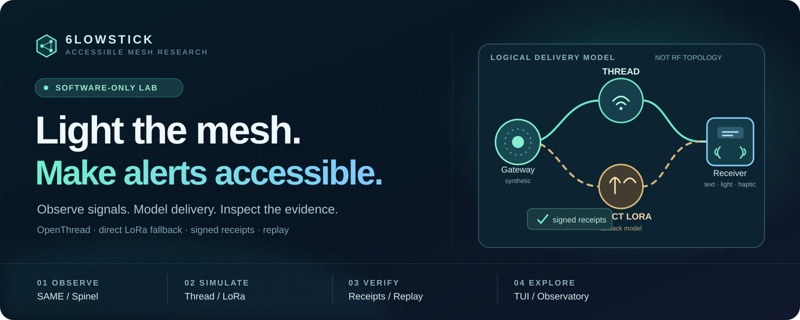
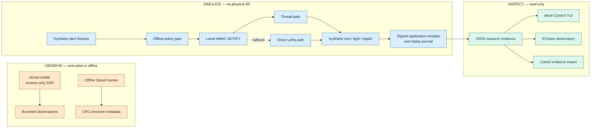

<div align="center">
  

  <p>
    <a href="https://mcc0nnell.github.io/6lowstick/"><strong>Explore Mesh Observatory ↗</strong></a>
    &nbsp; · &nbsp;
    <a href="#run-the-lab">Run the lab</a>
    &nbsp; · &nbsp;
    <a href="#the-system">Inspect the architecture</a>
    &nbsp; · &nbsp;
    <a href="docs/threat-model.md">Threat model</a>
  </p>

  <p>
    <code>NODE 22+</code> &nbsp; <code>APACHE-2.0</code> &nbsp; <code>SIMULATION FIRST</code> &nbsp; <code>READ-ONLY OBSERVABILITY</code>
  </p>
</div>

> [!IMPORTANT]
> **6lowStick is a research instrument, not an emergency warning system.** The notification fabric, Thread/LoRa failover, receivers, and observatory scenarios are **software-only simulations**. No operational alert is originated; no physical radio delivery or human receipt has been established.

# A research platform for the last meter of accessible alerting

A warning can be transmitted without being **received**. It can be received without being **perceived**. And it can be perceived without being **understood**.

6lowStick asks how low-power networks, diverse receiver modalities, authenticated application receipts, and reproducible evidence could help us study those gaps—without confusing a successful send with a successful warning.

| 01 / OBSERVE | 02 / MODEL | 03 / INSPECT | 04 / EVALUATE |
| :--- | :--- | :--- | :--- |
| Receive-only NOAA/SAME observations and offline Spinel bytes | Synthetic Thread delivery with scripted direct-LoRa fallback | Signed application receipts, replay suppression, JSON traces | Read-only terminal UI, ECharts observatory, accessible text reports |
| **Never grants dispatch authority** | **No physical RF** | **Not proof of actuation** | **Not proof of human comprehension** |

## See the experiment

**[Open the Mesh Observatory →](https://mcc0nnell.github.io/6lowstick/)**

The GitHub Pages experience offers five deterministic, synthetic fault scenarios, a logical route graph, application delivery-attempt comparisons, an evidence inspector, and an accessible attempt-by-attempt table. It visualizes **modeled delivery paths**, not captured RF topology or live devices.

Prefer the terminal? **Mesh Control** provides keyboard navigation, a text-reader view, `--plain`, `--reduced-motion`, and a complete `--report` for sequential evidence inspection.

## Run the lab

```bash
git clone https://github.com/mcc0nnell/6lowstick.git
cd 6lowstick
npm ci
npm test

# Navigate the read-only evidence TUI
npm run tui -- --demo

# Accessible, noninteractive text evidence
npm run tui -- --demo --report

# Deterministic, software-only Thread/direct-LoRa scenarios
npm run evidence:multiradio
```

**Node.js 22+** is required. The TUI `--demo` uses illustrative evidence, not live captures. `npm run tui -- --demo --snapshot --plain` produces a noninteractive, color-free snapshot.

To reproduce the separately built OpenThread POSIX laboratory, point `OT_CLI_PATH` to your own `ot-cli-ftd` and run `bash scripts/run-evidence.sh`. **The OpenThread binary build is not pinned or reproduced here**; interpret results accordingly.

## The system



**Read the boundaries, not just the arrows.** The observation and simulation lanes are intentionally disconnected: a received SAME line does **not** authorize a synthetic alert. The Spinel CRC checks frame integrity, **not** authenticity or message meaning. The fallback arrows are scripted application routes, not measured radio links. Signed ACKs attest to simulated application processing, **not** device actuation, visual perception, or human acknowledgment.

## Built vs. demonstrated

| Instrument | Demonstrated in the repository | Still to establish |
| :--- | :--- | :--- |
| **Thread alert lab** | OpenThread POSIX simulation, local HMAC, replay journal, synthetic modalities | RF delivery, reliable notifications, user outcomes |
| **Multi-radio fabric** | Scripted Thread/direct-LoRa fallback, per-attempt authenticated receipts, duplicate suppression | LoRa hardware, LoRaWAN, real failover |
| **NOAA SDR observer** | Decoder-line parsing and bounded mock/replay observations | Origin authentication, field measurements |
| **Spinel Flight Recorder** | Offline HDLC-lite frame parsing, CRC-16/FCS and raw command IDs | Live RCP capture, semantic radio state |
| **Matter adapter** | Pinned SDK seam with mock controller | Commissioned endpoints, verified physical output |
| **Mesh Control** | Read-only TUI, keyboard and text evidence views | Live neighbor topology, captured packet timing |
| **Camel exporter** | Sanitized research evidence export | Live alert routing or production Camel service |

> [!NOTE]
> **Reliability is an open research problem.** A previous four-node POSIX simulation intermittently missed a haptic ACK. A missing receipt is *unconfirmed*, not proof that no actuation occurred. We keep the failure visible rather than relaxing timeouts to make a chart green. See [known reliability gaps](docs/threat-model.md#observed-reliability-caveat-2026-10-20).

## Field notes & reproducibility

| Start here | What it contains |
| :--- | :--- |
| [Thread lab](experiments/thread-alert/README.md) | Reproduction and observed limitations |
| [Multi-radio experiment](docs/multiradio-fabric.md) | Attempt challenges, failover and deduplication |
| [SDR ingress](docs/sdr-ingress.md) | Receive-only NOAA/SAME observation pipeline |
| [Spinel Flight Recorder](docs/spinel-flight-recorder.md) | Byte-level parsing and FCS validation |
| [Mesh Control](docs/mesh-control-tui.md) | TUI controls, plain text, accessibility |
| [Matter adapter](src/matter/README.md) | SDK adapter and mock boundary |
| [Alert schema](docs/alert-schema.json) | Machine-readable synthetic message format |
| [Threat model](docs/threat-model.md) | Spoofing, replay, missing receipts and safety limits |

### Next experiments

1. Run repeated **timestamped simulated Thread trials** and characterize missing ACKs without weakening the confirmation gate.
2. Cross-check offline Spinel decodes against independent frame specimens before interpreting radio evidence.
3. Conduct authorized, isolated **physical-radio experiments** with provenance and applicable regulatory controls.
4. Evaluate whether text, light, and haptic outputs are actually **perceived and understood** by people—not merely accepted by software.

---

**Safety.** Do not connect this prototype to public warning origination, operational emergency dispatch, or uncommissioned actuators. NOAA/SAME reception is not authenticated; a local gateway HMAC does not authenticate NOAA. [Apache License 2.0](LICENSE).

<sub>Built as an experimental accessibility and low-power networking laboratory. WindAnvil and TalkPipe can support development workflows; neither is required at runtime.</sub>
