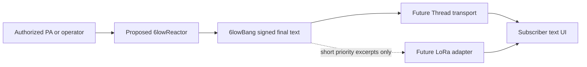

# 6lowBang — captions and acoustic context over 6lowStick

**6lowLoop finds your people. 6lowFlare lets them signal. 6lowBang brings spoken information and described sound events to an accessible local feed.**

## Experience and architecture

At a festival, a Deaf attendee selects *Main Stage — English* and reads finalized captions and source-supplied sound descriptions without requiring a location share or mandatory cloud account. A proposed venue-side **6lowReactor** transcribes authorized PA/microphone audio offline or accepts operator-provided captions. **6lowBang only transports signed text.** It does not capture audio, recognize speech, automatically classify sounds or translate languages. A future 6lowLoop interface would show accessible captions; 6lowSpark may eventually offer opt-in haptics.



## Executable first slice

```sh
npm run bang:demo
node --test test/bang.test.mjs
```

The Node 22+ implementation is an **entirely process-local simulation**. Demo keys are ephemeral and demo text is synthetic. There is no network, audio recognizer, radio hardware, connected phone, Matrix session, or physical notification.

- `create6lowBangSource({channel, language, privateKey, session})` emits `caption` or source-authored `sound` events using a provisioned Ed25519 private key.
- Each v1 event has signed version, event kind, channel, language, 128-bit session identifier, increasing sequence number, source timestamp, expiry and UTF-8 text (up to 96 bytes). Default lifetime is 15 seconds; maximum is 30 seconds.
- `create6lowBangReceiver({channels:[{id,publicKey}]})` starts disabled and requires a known, pinned publisher public key plus explicit subscription before it admits an event.
- Verification covers metadata and text. Tampering, forgery under another key, stale frames, duplicates, invalid fields and frames outside a 32-sequence window are rejected.
- Out-of-order signed text is buffered until consecutive frames arrive. Caller-driven `flush(channel, session, {now, holdMs})` reports missing sequence numbers (250 ms default hold) and releases queued text without inventing words. The caller must schedule its own timeout.
- Disabling or unsubscribing clears volatile local state; active sessions and channel provisioning are bounded.

**Receipt is only authenticated application admission.** It does not establish that a user saw captions, that a device actuated, or that anyone understood the message.

## Important protocol and security limits

These are **JSON model objects, not an RF codec**. An Ed25519 signature alone occupies 64 bytes. A Thread/IEEE 802.15.4 PHY frame holds no more than 127 bytes before MAC, security, 6LoWPAN and transport overhead. A compact bounded frame encoding, segmentation strategy, measured airtime, bandwidth and packet-loss behavior all remain to be designed. LoRa must be evaluated separately for brief prioritized text; continuous caption fan-out cannot be assumed.

Ed25519 authenticates a pinned publishing key **but does not encrypt captions** and does not establish the *truth* of their contents. Public venue caption feeds and private conversations require distinct confidentiality/consent policies. Private captions must not be broadcast in plaintext. Key provisioning, authenticated late-join sequence bootstrap, key rotation/revocation, signed caption corrections, transport encryption and secure source enrollment are not implemented. In this model, every new session starts at sequence 1; joining late requires a future authenticated bootstrap.

Caption and sound-event descriptions must come from an authorized source. The `[APPLAUSE]` marker in the demo is supplied as text, not detected by a classifier. Retention should be minimal; microphone capture requires consent and a clearly communicated policy. Never convert uncertain speech recognition into emergency instructions or operational alerts.

## Integration gates

1. Add a synthetic caption-source adapter to the proposed 6lowReactor boundary, then separately integrate operator feeds and licensed/offline ASR.
2. Define compact wire frames, publisher discovery, explicit channel provisioning, late joining, loss/gap handling and key rotation.
3. Run a simulated OpenThread POSIX fan-out with reordering, loss, duplications, partitions, congestion and process-observed latency measurements.
4. Build an accessible opt-in 6lowLoop caption UI with text scaling, screen readers, clear gaps, and optional haptics; keep private feeds confidential.
5. Validate on an authorized physical Thread bench, then separately investigate bounded LoRa fallback. Record independent evidence for radio receipt and human comprehension.

See [6lowLoop](6lowloop.md), [6lowFlare](6lowflare.md), [6lowSpark](6lowspark.md), [threat model](threat-model.md) and [physical radio protocol](physical-radio-test-protocol.md).
