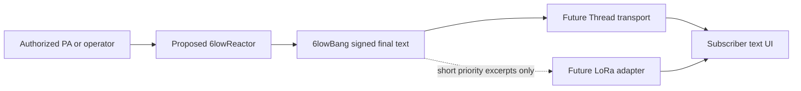

# 6lowBang — captions and acoustic context over 6lowStick

**6lowLoop finds your people. 6lowFlare lets them signal. 6lowBang brings spoken information and described sound events to an accessible local feed.**

## Experience and architecture

At a festival, a Deaf attendee selects *Main Stage — English* and reads finalized captions and source-supplied sound descriptions without requiring a location share or mandatory cloud account. A proposed venue-side **6lowReactor** transcribes authorized PA/microphone audio offline or accepts operator-provided captions. **6lowBang only transports signed text.** It does not capture audio, recognize speech, automatically classify sounds or translate languages. A future 6lowLoop interface would show accessible captions; 6lowSpark may eventually offer opt-in haptics.



## Native C11 core and JavaScript reference

**C is the protocol authority.** `native/bang/` is a standalone C11 static library using OpenSSL `libcrypto` for Ed25519. The signing core has no Celix, Node.js, cloud service or audio dependency; optional binary wire and loopback transports are now separate C libraries. CMake 3.16+, a C11 compiler and OpenSSL development headers are required to build.

```sh
npm run bang:native:test
npm run bang:native:demo
# Directly, without npm:
cmake -S native/bang -B /tmp/bang-build
cmake --build /tmp/bang-build
ctest --test-dir /tmp/bang-build --output-on-failure
```

The public API is `native/bang/include/lowbang.h`: `bang_source_new/emit/free` signs events using a provisioned Ed25519 seed; `bang_receiver_provision/enable/subscribe/receive/flush/disable/free` validates a publisher-pinned public key and emits bounded, ordered captions with explicit gap reports. The caller provisions channel keys and a unique 128-bit session identifier out of band and schedules flush deadlines. No secret key is written to a repository file in the example: its constant is **synthetic test data only**, not production key material.

The C core signs the original JS reference's domain-separated canonical JSON payload. Native tests assert two fixed Ed25519 signature vectors generated using Node.js 22; this preserves the signed-message format for the current subset. The existing `src/bang/core.mjs` and `test/bang.test.mjs` are **JavaScript simulation/reference code**, not the production signing or receive path; `npm run bang:demo` runs that reference separately. There is no browser UI yet. The native C OpenThread UDP lab (6lowbang-native-openthread.md) now exercises binary signing and receiving over two simulated Thread nodes. See the 6s-owned C transport guide (6lowbang-transport.md) for bounded UDP and OpenThread POSIX test-only bridges.

Each v1 model event contains an authenticated event kind (`caption` or source-authored `sound`), channel, language, 128-bit session identifier, monotonic per-session sequence, source time, expiry and UTF-8 text (at most 96 bytes). Maximum time-to-live is 30 seconds; receiver reorder window is 32 positions; maximum 16 provisioned channels and 32 tracked sessions. A receiver starts disabled, needs an explicit subscribed channel, checks signatures and expiry and rejects tampering, replays and out-of-window frames. `bang_receiver_flush` reports skipped sequences only after a caller-scheduled timeout; it never manufactures missing words.

**Celix boundary:** the `lowbang` C library can be linked by a future Apache Celix service bundle. This PR does **not** add a Celix bundle, lifecycle management, service registration, network adapter, or message queue. A service adapter should explicitly own key provisioning, authorization, source capture, transport selection and bounded subscriptions, without giving text processing emergency dispatch authority.

**Evidence:** this is a process-local software model. Neither passing native and JS tests nor matching signatures proves speech recognition, live captions, RF delivery, device action or human comprehension. Keys in tests and demos are deliberately fixed research fixtures.

## Important protocol and security limits

The C structs and JS reference objects are protocol models. The new bounded binary envelope is experimental and NOT a single-frame RF codec. An Ed25519 signature alone occupies 64 bytes. A Thread/IEEE 802.15.4 PHY frame holds no more than 127 bytes before MAC, security, 6LoWPAN and transport overhead. The current bounded binary encoding needs a real segmentation strategy, measured airtime, bandwidth and packet-loss evaluation before on-air use. LoRa must be evaluated separately for brief prioritized text; continuous caption fan-out cannot be assumed.

Ed25519 authenticates a pinned publishing key **but does not encrypt captions** and does not establish the *truth* of their contents. Public venue caption feeds and private conversations require distinct confidentiality/consent policies. Private captions must not be broadcast in plaintext. Key provisioning, authenticated late-join sequence bootstrap, key rotation/revocation, signed caption corrections, transport encryption and secure source enrollment are not implemented. In this model, every new session starts at sequence 1; joining late requires a future authenticated bootstrap.

Caption and sound-event descriptions must come from an authorized source. The `[APPLAUSE]` marker in the demo is supplied as text, not detected by a classifier. Retention should be minimal; microphone capture requires consent and a clearly communicated policy. Never convert uncertain speech recognition into emergency instructions or operational alerts.

## Integration gates

1. Add a synthetic caption-source adapter to the proposed 6lowReactor boundary, then separately integrate operator feeds and licensed/offline ASR.
2. Define compact wire frames, publisher discovery, explicit channel provisioning, late joining, loss/gap handling and key rotation.
3. Extend the working OpenThread POSIX two-node lab to simulated loss, duplications, partitions, congestion and robust process-observed latency distributions; the C-native OpenThread binding is now available for further testing.
4. Build an accessible opt-in 6lowLoop caption UI with text scaling, screen readers, clear gaps, and optional haptics; keep private feeds confidential.
5. Validate on an authorized physical Thread bench, then separately investigate bounded LoRa fallback. Record independent evidence for radio receipt and human comprehension.

See [6lowLoop](6lowloop.md), [6lowFlare](6lowflare.md), [6lowSpark](6lowspark.md), [threat model](threat-model.md) and [physical radio protocol](physical-radio-test-protocol.md).
