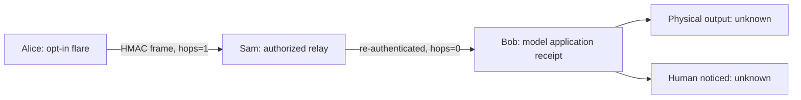

# 6lowFlare — signal what matters

**6lowLoop finds your people. 6lowFlare lets a group signal. 6lowStick
investigates how a signal can become a perceptible physical event.**

6lowFlare is a core product direction, not another emergency-only alert
protocol. The first implementation deliberately models a narrow question:

> Can an opt-in participant issue a short-lived signal to a prearranged
> audience, have another authorized node relay it, and avoid pretending that
> an application's receipt means a person noticed anything?

**Current answer:** yes as a process-local, authenticated relay *model*.
There is no actual network, location discovery, Matrix login, radio,
physical activation, public broadcasting or human-receipt measurement.

## The first slice

Run from the repository root with Node 22+:

```sh
npm run flare:demo
node --test test/flare.test.mjs
```

`src/flare/core.mjs` exports `create6lowFlare` and `flareCodes`.
An endpoint starts disabled unless explicitly enabled. Relay permission is
independent and defaults to off.

1. Pre-provision an `audience` with an arbitrary **local** label, unique
   32-byte key, and allowed codes; keys must be distributed through a trusted
   out-of-band path. Neither Matrix nor radio pairing exists here.
2. Enable the sender and choose an authorized audience and one of the
   controlled semantic codes: `here`, `rendezvous`, `attention`, `assistance`.
   There is no free-form text, GPS coordinate, user ID, or message body.
3. `flare(audience, code, {now, ttlMs, hops})` returns a HMAC-authenticated
   frame containing a minute-rotated, audience-keyed token, fresh 12-byte
   nonce, expiration and signed hop budget. Maximum TTL: **120 seconds**.
   Maximum relay budget: **4**.
4. `receive(frame, {now})` checks schema, MAC, group membership, code
   authorization, lifetime, and process-local replay journal. It returns
   a modeled application admission event and, **only if separately opted
   into relay**, a newly authenticated frame with one fewer hop remaining.
5. Application admission may include local requested modality **labels**
   (`text`, `haptic`, `light`). No code opens a radio, emits a notification
   or drives an actuator. `physicalOutput`, `humanDetected` and
   `humanUnderstood` are always `unknown`.



The simulator caller wires these frames together manually; there is
**no transport abstraction or automatic rebroadcast loop** in this PR.

## 6lowFlare versus 6lowLoop

| | 6lowLoop | 6lowFlare |
| --- | --- | --- |
| Human purpose | Find/reach a mutually paired friend | Signal a purpose to an authorized audience |
| First executable slice | Opt-in in-memory presence and ping/ACK | Opt-in in-memory bounded audience flare and relay |
| Credentials today | Pairwise friend HMAC keys labeled with Matrix IDs | Distinct pre-provisioned per-audience HMAC keys |
| Radio, location or internet | None | None |
| Planned relationship to Matrix | Verified identity, encrypted messaging and group membership | Future authorized group/addressing adapter; **not** Matrix traffic |

## What the security boundary actually means

- **Audience membership is not individual sender attribution.** Every node
  holding a shared group key can originate or re-sign a flare; these frames
  do not prove which group member sent them. Relays that possess the key can
  also re-sign the hop budget, so the decrement is a **cooperative model**,
  not Byzantine-resistant enforcement.
- **HMAC is not encryption.** The purpose code, nonce, timestamps and hop
  budget remain readable to passive observers. Tokens rotate each minute
  but can still be linked within a window. Traffic timing can reveal
  presence even without a location field.
- **No public flare mode.** An unauthenticated stranger cannot join,
  receive or rebroadcast. Actual public/community signaling needs a
  separately designed trust, consent, abuse and relay-budget policy.
- **No automatic discoverability.** Access to an audience key is a manual
  assumption in this lab, not evidence of consent, correct group
  membership, device verification or permission to reveal someone's
  whereabouts. A production version needs block/revoke, secure key
  distribution, rotation, lost-device handling, anti-stalking controls
  and an immediately accessible stop/disappear affordance.
- **No persistent replay defense.** The cache is bounded to 1,024
  observations and volatile; restart, compromise, colliding nonces,
  clock manipulation and real network partitions require further work.
- **No operational alerts.** `assistance` is a synthetic purpose label,
  not an authenticated emergency declaration. This prototype must not
  originate public warnings, actuate devices or trigger safety responses.

## Evidence ladder / next integration gates

1. Wire a **separate opt-in simulated transport adapter** to the existing
   OpenThread POSIX research bench; document packet size, retries,
   duplicates, explicit device/audience pairing and relay loops.
2. Integrate real Matrix identity/device verification and membership
   through an explicitly authorized bridge. Matrix homeservers and E2EE
   sessions are not replaced by offline HMAC frames.
3. Add independent permission checks and recipient-controlled output
   preferences for text, haptic and light. Record the **device action**
   independently from application receipt.
4. Measure physical RF delivery on an authorized bench, including
   Thread/Spinel, separate direct-LoRa transport and network partitions.
5. Validate human detection and comprehension through consent-based
   accessible testing. No synthetic test can establish life-safety reliability.

See [6lowLoop](6lowloop.md), [signal intent](first-light/README.md),
[physical radio protocol](physical-radio-test-protocol.md) and
[threat model](threat-model.md) for adjacent boundaries.
