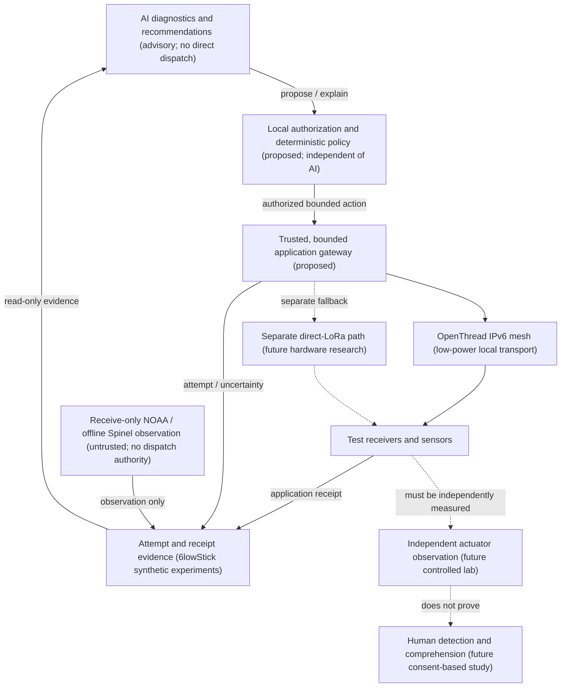

# OpenThread, AI, and accountable physical systems

**Status: research direction, not an implemented AI subsystem.** Updated 2026-10-22.
6lowStick is simulation-first research software, **not** an operational warning system.
No AI agent, model-driven dispatch, physical radio failover, autonomous actuator
control, or human-recipient verification is demonstrated by this document.

## Thesis

An AI system can help *interpret* a physical environment, but it should not
become the authority that determines whether a warning was delivered or whether
a physical action happened.

Our working separation is:

- **OpenThread:** an IPv6 mesh transport over IEEE 802.15.4 for low-power local
  devices. It is not an AI runtime, a long-range LoRa mesh, or a proof of
  delivery to a person.
- **Local observation and policy gateway (proposed):** translate explicitly
  authorized, bounded device events into provenance-tagged observations;
  enforce identity, policy, rate limits, and safe actions independently of AI.
- **AI analysis (proposed):** correlate observations, explain uncertainty,
  diagnose mesh behavior, recommend next steps, and help design tests. Its
  output is advisory and untrusted until verified and authorized.
- **6lowStick:** exercise and inspect attempts, application receipts,
  suppression of duplicates, and incomplete outcomes. It asks *what can the
  evidence actually establish?* Current simulated activation is not measured
  hardware actuation or human perception.
- **Separate fallback radio (research):** direct LoRa may carry a compact
  application message when the Thread path is unconfirmed. This is
  **application-layer forwarding**, not transparent Thread-to-LoRa IP routing;
  the existing LoRa leg is scripted software only.

### Intended architecture

**Text equivalent:** An AI assistant reads experimental evidence and proposes
diagnoses or actions. A separate deterministic authorization boundary must
approve any action before a gateway can address low-power devices via
OpenThread. A future direct-LoRa link would be a separate application
transport. Receivers supply application receipts to an evidence journal.
Independent instruments would need to confirm physical output; participant
studies would need to evaluate detection and comprehension. Receive-only
NOAA/SAME and offline Spinel observations may inform analysis but can never
originate alerts. **The diagram describes possible future integration, not
connections present in today's prototype.**

## What a receipt actually means

| Evidence level | What it supports | What it does not support |
| --- | --- | --- |
| Command/request accepted | A caller or local process accepted a request | Transmission, delivery, or execution |
| Transport attempt recorded | An attempt was made over a named route | Packet arrival or receiver execution |
| Authenticated application receipt | A lab recipient processed a challenge-bound application message | Actual light/vibration, correct identity under compromised shared keys, or a person noticing |
| Device output independently measured | An instrument observed test-only electrical/optical/mechanical output | A person perceived or understood it |
| Person reports detection | A consenting participant noticed the test notification | That they interpreted its meaning correctly |
| Person demonstrates comprehension | A defined study measured understanding in its stated setting | Guaranteed outcomes for all people or conditions |

An absent receipt is **unconfirmed**, not proof that nothing happened.
A duplicate receipt is not a second notification. Every derived AI assertion
must name its evidence source and retain unknown or contradictory states;
confidence prose cannot promote a simulated receipt to an observed physical
outcome.

The current synthetic protocol uses per-attempt challenges, authenticated R2
application receipts, and a durable replay journal. These are laboratory
controls, not production device identity, provisioning, or actuation proofs.
See [multi-radio fabric](multiradio-fabric.md) and
[threat model](threat-model.md).

## Useful AI work that does not require actuator authority

1. **Mesh diagnosis:** summarize simulated node reachability, application-ACK
   gaps, partitions, and retransmission hypotheses using captured facts. Do
   not claim an RF root cause from harness timing or missing UDP ACK alone.
2. **Experiment design:** propose bounded fault-injection cases, baseline
   controls, sample sizes, and measures, then let deterministic tooling run
   approved synthetic trials.
3. **Evidence interpretation:** compare traces against explicit invariants:
   single activation per alert ID, new attempt challenge on fallback,
   authenticated receiver application ACK, and accurate `unconfirmed` states.
4. **Operator explanation:** present text-first incident timelines and
   accessibility-aware summaries with links back to raw records. Never make
   the visual topology illustration the sole source of information.
5. **Future sensor correlation:** infer possible environmental events from
   independently authenticated, time-bounded local observations. Never
   convert a model's inference into an operational alert without separate
   source validation and authorization.

None of these require an LLM on every Thread device. Analysis can run on a
local or remote gateway; network safety and application correctness must not
depend on a model or cloud connection being available.

## Trust rules for any future agent integration

- **No authority laundering:** model output, tool output, decoded radio text,
  or retrieved documents must not grant permission to dispatch. Ingested
  sensor data and packets are untrusted input; prompt injection is an
  expected threat.
- **Constrained commands:** any future control request must use a typed,
  allowlisted schema and explicit operator/policy authorization. No
  unrestricted shell, arbitrary recipient selection, or unconstrained tool
  execution from a model.
- **Provenance before inference:** record observation source, timestamps,
  device identity assumptions, firmware/source version, simulation flag,
  attempt/alert IDs, and missing data; never invent unavailable telemetry.
- **Privacy by default:** minimize and locally retain only needed telemetry;
  establish consent, retention, access controls, and separation of
  participant data before gathering environmental or behavioral signals.
- **Deterministic fallback:** loss of AI or cloud connectivity must not disable
  existing deterministic lab protections, replay suppression, or safe-stop
  behavior. It must not cause an agent to improvise an alternate dispatch
  route.
- **Fail safely:** unknown authentication, expired data, policy ambiguity,
  compromised keys, conflicting sensor reports, and lost receipts require
  explicit unresolved/denied states rather than confident fabricated success.

AI-generated explanations and proposals should be auditable records with
input references and model/configuration versions, not evidence of a
receiver's physical response.

## Work program and honest gates

| Phase | Proposed deliverable | Pass condition | Current state |
| --- | --- | --- | --- |
| 0. Simulation evidence | Reproducible OpenThread POSIX and scripted route experiments | Retain failed and incomplete runs; compare source/binary versions | Existing labs; unresolved intermittent ACK history; PR #8 separately explores POSIX-to-scripted fallback |
| 1. Read-only AI evaluator | Consume exported *synthetic* trace data and produce cited diagnostics | No dispatch endpoint or write privilege; flag false claims about receipt/actuation against labeled fixtures | Deterministic reference and typed claim checker implemented; AI model integration not implemented |
| 2. Proposed-action boundary | Typed advisory requests reviewed against deterministic policy | Reject unapproved targets, stale input, injection attempts, and missing evidence | Not implemented |
| 3. Controlled hardware lab | Authorized 802.15.4 and separately reviewed direct-LoRa bench; instrumented output | Measured packet/receipt/output records with uncertainty and failure denominators | Not implemented |
| 4. Human-centered validation | Opt-in accessible text, light, and haptic research | Separate detection and comprehension measurements; consent and privacy review | Not implemented |

For hardware acquisition and experiment stop conditions see the
[physical-radio protocol](physical-radio-test-protocol.md); for repeated
simulation limits see [reliability trials](reliability-trials.md).
Passing a software gate does not imply permission or readiness for the next.

The first deterministic [offline trace reviewer](trace-review.md) is now implemented for the five committed scripted Field Station scenarios. It emits source references and unknown physical/human outcomes and rejects unsupported typed claims. It has **no AI model**, and it does not yet evaluate a stopped physical or POSIX node as a committed fixture.

### First narrowly scoped implementation experiment

Build an **offline, read-only trace evaluator** with a fixed set of
synthetic cases: healthy application ACK, missing receipt, invalid receipt,
cross-transport duplicate, and receiver stopped. Require a structured
output with: `scenario_id`, grounded trace references, observed
application state, explicitly unknown physical/human outcomes, hypotheses,
and proposed next *test* (not an action). Compare it to deterministic
expectations; record hallucinated receipts and mistaken claims of actuation
as evaluation failures. This can be tested without any radio equipment,
external service, or new dispatch capability.

## The larger opportunity

A low-power mesh can supply local connectivity; edge computation can
interpret observations; independently enforced policy can constrain
actions; and evidence collection can tell us what actually occurred.
That makes buildings, environmental monitoring, distributed infrastructure,
and accessible notification research plausible domains for **accountable
physical AI**. These are research applications, not deployment claims,
reliability promises, or assertions of existing funding.

**Principle:** AI interprets; deterministic systems authorize; OpenThread
transports; instruments and people verify outcomes.

Related: [research guide](README.md) ·
[reliability trials](reliability-trials.md) ·
[Field Station](field-station.md) ·
[physical-radio protocol](physical-radio-test-protocol.md).
